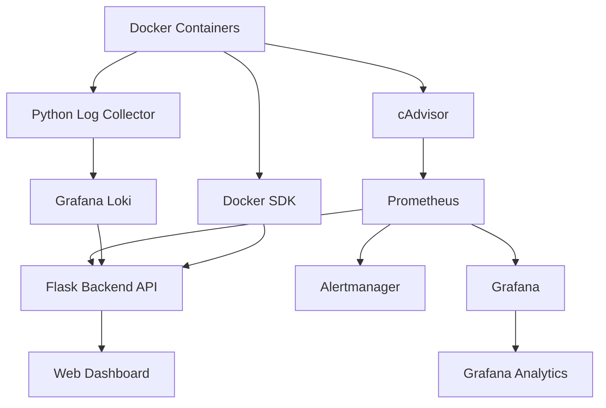

# 🚀 DevOps Monitoring & Logging Platform

A Docker-based monitoring and centralized logging platform built using **Python Flask, Prometheus, cAdvisor, Grafana Loki, Grafana and Docker Compose**.

The platform helps monitor Docker containers, track CPU and memory usage, collect application logs, visualize performance metrics and manage system alerts through a centralized dashboard.

---

## 📌 Project Overview

The DevOps Monitoring & Logging Platform provides a centralized view of Docker container health, resource utilization and application logs.

It combines metrics collection, log aggregation and visualization tools to simplify infrastructure monitoring and troubleshooting.

### Key Highlights

- Real-time Docker container monitoring.
- CPU and memory utilization tracking.
- Historical performance visualization using Chart.js.
- Centralized log collection using Grafana Loki.
- Container log filtering and searching.
- Prometheus-based monitoring and alert rules.
- Grafana dashboards and data source provisioning.
- Docker Compose-based deployment.
- Windows startup and shutdown automation scripts.

---

## 🏗️ System Architecture



### Architecture Workflow

1. Docker runs the application containers.
2. cAdvisor collects container resource metrics.
3. Prometheus scrapes and stores time-series metrics.
4. Python Log Collector collects Docker container logs.
5. Loki stores and provides access to collected logs.
6. Flask retrieves metrics, logs and container information.
7. The frontend displays monitoring information.
8. Grafana provides additional analytics and visualization.
9. Alertmanager handles notifications generated by Prometheus alert rules.

---

## 🛠️ Technology Stack

| Component | Technology | Purpose |
|---|---|---|
| Frontend | HTML5, CSS3, JavaScript | Dashboard interface |
| Charts | Chart.js | Performance visualization |
| Backend | Python 3.12, Flask | REST API |
| Container Monitoring | Docker SDK | Container information |
| Metrics Export | cAdvisor | Resource metrics |
| Metrics Storage | Prometheus | Time-series monitoring |
| Log Aggregation | Grafana Loki | Centralized logs |
| Log Collection | Python | Docker log shipping |
| Visualization | Grafana | Monitoring dashboards |
| Alert Management | Alertmanager | Alert routing |
| Orchestration | Docker Compose | Service management |

---

## ✨ Features

### 1. Real-Time Monitoring Dashboard

- Displays CPU utilization.
- Displays memory consumption.
- Shows Docker container count.
- Provides system health information.
- Automatically refreshes monitoring data.

### 2. Historical Performance Monitoring

- CPU usage trend visualization.
- Memory usage trend visualization.
- Historical metrics through Prometheus queries.
- Interactive charts using Chart.js.

### 3. Docker Container Monitoring

- Container discovery using Docker SDK.
- Container status monitoring.
- CPU and memory usage information.
- Container lifecycle monitoring.
- Container uptime information.

### 4. Centralized Log Management

- Collects Docker container logs.
- Sends logs to Grafana Loki.
- Displays logs through the dashboard.
- Supports container-based filtering.
- Supports keyword searching.
- Provides severity-based filtering.
- Includes auto-scroll controls.

### 5. Alert Management

Prometheus alert rules can monitor conditions such as:

- High container CPU usage.
- High container memory usage.
- Unavailable monitoring services.
- Container failures.

Alertmanager handles alert grouping and routing.

### 6. Grafana Integration

- Prometheus data source configuration.
- Loki data source configuration.
- Provisioned monitoring dashboards.
- Additional performance analytics.

### 7. Deployment Automation

- Docker Compose configuration.
- Windows startup script (`start.bat`).
- PowerShell startup script (`start.ps1`).
- Shutdown script (`stop.bat`).

---

## 📂 Project Structure

```text
monitoring-logging-system/
│
├── app/
│   ├── app.py
│   ├── requirements.txt
│   │
│   ├── templates/
│   │   └── dashboard.html
│   │
│   └── static/
│       ├── css/
│       │   └── style.css
│       │
│       └── js/
│           └── dashboard.js
│
├── alertmanager/
│   └── alertmanager.yml
│
├── prometheus/
│   ├── prometheus.yml
│   └── alert.rules.yml
│
├── grafana/
│   └── provisioning/
│       ├── datasources/
│       │   └── datasources.yml
│       │
│       └── dashboards/
│           ├── dashboards.yml
│           └── docker-monitoring.json
│
├── log_collector.py
├── Dockerfile
├── docker-compose.yml
├── prometheus.yml
├── prometheus-backup.yml
├── start.bat
├── start.ps1
├── stop.bat
└── README.md
```

---

## ⚙️ Prerequisites

Install the following before running the project:

- Python 3.12 or later.
- Docker Desktop.
- Docker Compose v2.
- Git.
- A web browser.

Make sure Docker Desktop is running before starting the platform.

---

## 🚀 Installation and Setup

### Step 1: Clone the repository

```bash
git clone https://github.com/Athisha1718/monitoring-logging-system.git
```

### Step 2: Navigate to the project directory

```bash
cd monitoring-logging-system
```

### Step 3: Start the platform

On Windows CMD:

```cmd
start.bat
```

Alternatively, use Docker Compose:

```bash
docker compose up -d --build
```

### Step 4: Check running containers

```bash
docker compose ps
```

### Step 5: Access the dashboard

Open the dashboard in your browser:

```text
http://localhost:5000
```

### Stop the platform

```cmd
stop.bat
```

Alternatively:

```bash
docker compose down
```

Note: `docker compose down` preserves named volumes unless the `-v` option is specified.

---

## 🌐 Service Endpoints

| Service | Port | URL |
|---|---:|---|
| Flask Dashboard | 5000 | http://localhost:5000 |
| Grafana | 3000 | http://localhost:3000 |
| Prometheus | 9090 | http://localhost:9090 |
| Alertmanager | 9093 | http://localhost:9093 |
| cAdvisor | 8888 | http://localhost:8888 |
| Grafana Loki | 3100 | http://localhost:3100 |

The actual ports depend on the Docker Compose port mappings.

---

## 🔌 Backend API Endpoints

| Endpoint | Method | Description |
|---|---|---|
| `/` | GET | Dashboard interface |
| `/api/metrics` | GET | Overall monitoring metrics |
| `/api/metrics/history` | GET | Historical metrics |
| `/api/containers` | GET | Container information |
| `/api/logs` | GET | Aggregated container logs |
| `/api/alerts` | GET | Active monitoring alerts |
| `/api/health` | GET | Service health check |

Check the implemented Flask routes for the exact availability and response formats of each endpoint.

---

## 🔍 Monitoring and Troubleshooting

### Check Docker containers

```bash
docker ps
```

### Check container logs

```bash
docker logs <container-name>
```

### Check Docker Compose services

```bash
docker compose ps
```

### Check Prometheus targets

Open:

```text
http://localhost:9090/targets
```

### Check Loki readiness

```text
http://localhost:3100/ready
```

---

## 🔐 Security Considerations

- Do not commit passwords, API keys or access tokens.
- Keep `.env` files out of version control.
- Change default Grafana credentials before deployment.
- Restrict access to monitoring endpoints.
- Use appropriate authentication and authorization.
- Configure secure access before exposing services publicly.

---

## 🎯 Future Enhancements

- Advanced container health monitoring.
- Email and messaging notifications.
- Improved alert escalation.
- Log anomaly detection.
- AI-assisted log analysis.
- Kubernetes monitoring integration.
- Role-based dashboard access.
- Enhanced historical analytics.

---

## 👩‍💻 Author

**Athisha L**

B.E. Computer Science and Engineering – Cyber Security

GitHub: [Athisha1718](https://github.com/Athisha1718)

Project Repository: [DevOps Monitoring & Logging Platform](https://github.com/Athisha1718/monitoring-logging-system)

---

## 📜 License

This project is available for educational and learning purposes. Add an appropriate open-source license if you intend to permit reuse and redistribution.
